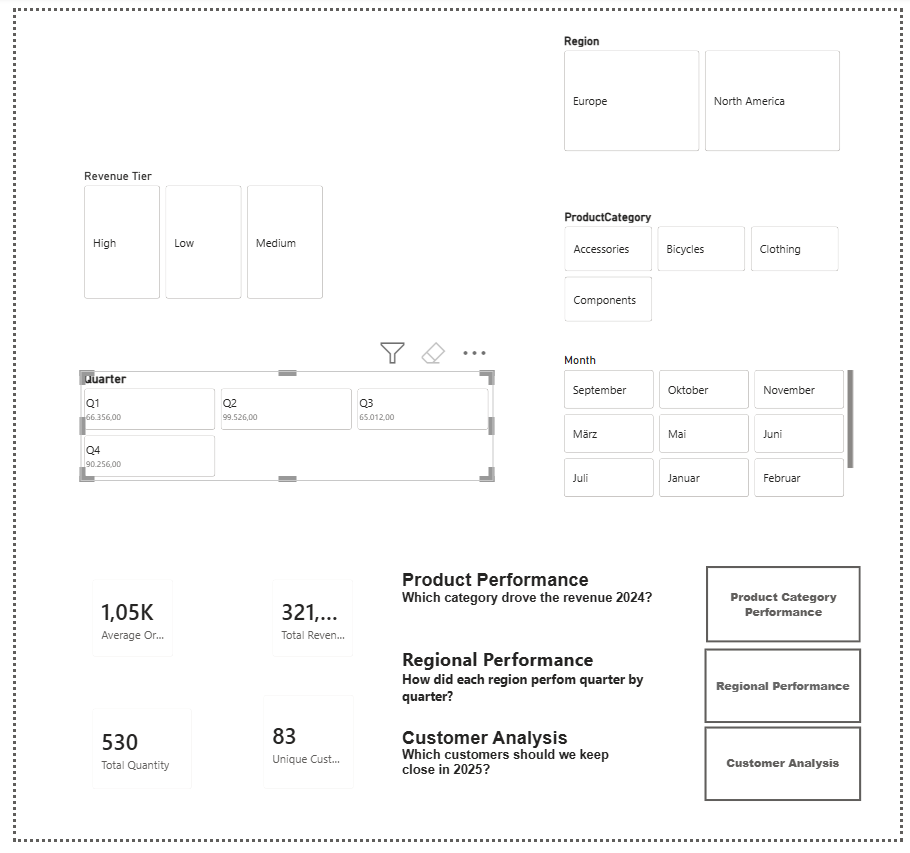

# PeakFlow Online Sales 2024 – Power BI Dashboard

Final project for Term 1 of the Data Analyst program at Masterschool. PeakFlow sells bikes, components, clothing and accessories online in Europe and North America. The raw export held 320 orders from 2024 and was not usable as it was.



## The questions

1. Which product categories drove revenue in 2024?
2. How did each region develop quarter by quarter?
3. Which customers should PeakFlow keep close in 2025?

## Data cleaning (Power Query)

- 9 region spellings reduced to 2, 24 category spellings reduced to 4
- 4 date formats turned into one
- Prices converted from text, spaces trimmed, 3 missing customer IDs restored via email
- 15 rows removed: 8 duplicate order IDs, 4 negative quantities (returns booked as orders), 3 rows without a price

Result: 305 clean orders.

## Data model

Star schema with one fact table (FactOrders) and four dimensions: product, customer, date and region. All relationships are one-to-many from the dimension to the fact table.

Revenue is calculated row by row:

```DAX
Revenue = SUMX(FactOrders, FactOrders[Quantity] * FactOrders[UnitPriceUSD])
```

Further measures cover average order value, category share and revenue tiers.

The report has an overview page plus one page per question, with the same slicers (region, category, quarter, month) on every page.

## Results

| Metric | 2024 |
|---|---|
| Revenue | $321,150 |
| Orders | 305 |
| Units sold | 530 |
| Customers | 83 |
| Average order value | $1,053 |

- **Products:** bicycles and components bring in 93% of revenue. Bicycles alone make up 59% from a quarter of all orders.
- **Regions:** Europe peaks in spring (Q2: $56,292), North America at year end (Q4: $55,066). Over the year both end up almost level.
- **Customers:** the top 17 customers (20%) bring in half of all revenue.

## Quality check

The first version of the dashboard showed $1,371,517 in revenue. A merge with the region lookup had copied order rows up to five times. After removing the duplicates and keeping one row per order ID, the total matches a simple sum of the raw data: $321,150.

Lesson: reconcile every dashboard total with the source before sharing it.

## Limits

- One year of data only, so seasonal patterns are not yet trends
- Online orders only, no store or B2B sales
- Revenue, not profit: no cost data
- Customer names are not unique (16 names across 83 IDs), so the customer ID is the only reliable key

## Files

- `Power BI Abschlussarbeit Term1 Denise Tirrel.pbix` – the Power BI report (open with Power BI Desktop, free)
- `dashboard-overview.png.png` – screenshot of the overview page

## Tools

Power BI Desktop · Power Query · DAX

---

Denise Tirrel · [LinkedIn](https://www.linkedin.com/in/denise-tirrel-2395ba446)
